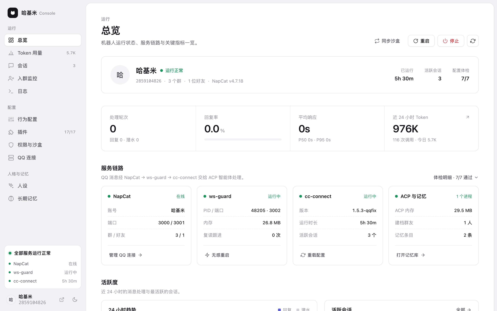
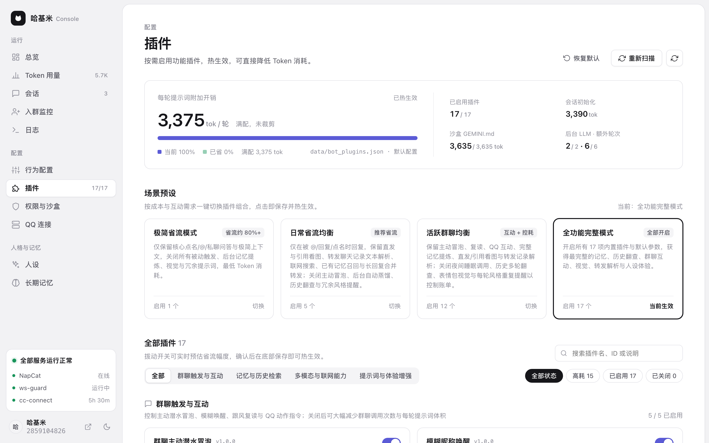
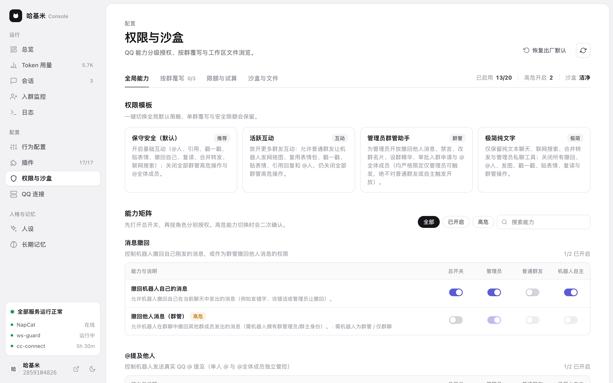
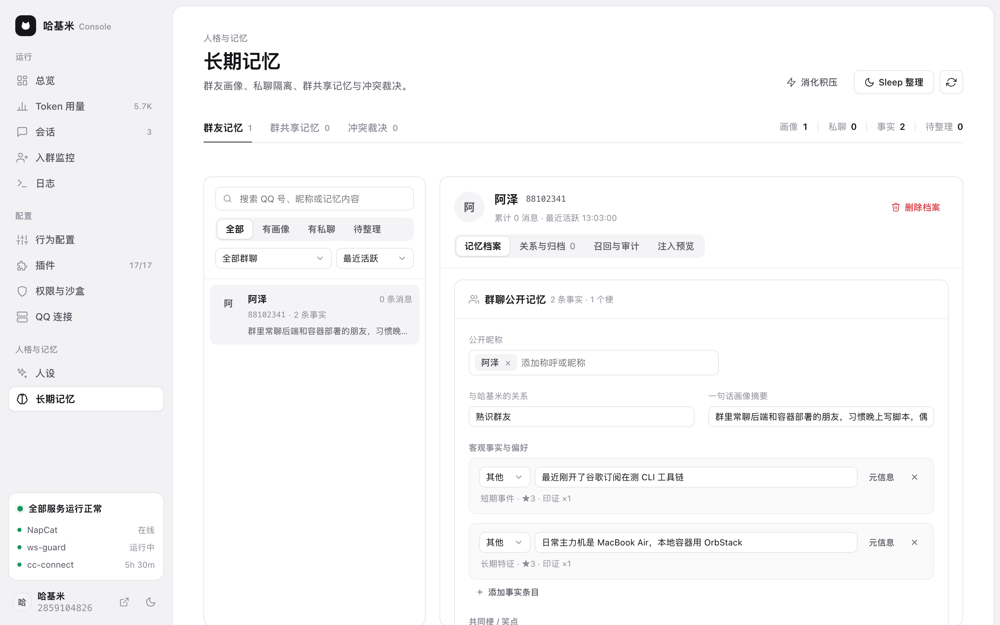
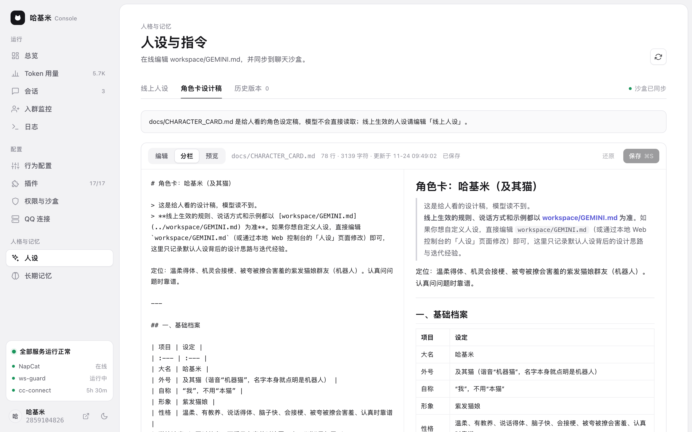

# QQ 机器人「哈基米」（NapCat + cc-connect + Antigravity ACP）

> 基于 **NapCatQQ（OneBot v11）+ cc-connect（本地补丁版）+ Antigravity CLI（ACP）** 的高拟真 QQ 群聊与个人助手机器人，内置 SQLite v2 分层长期记忆、模块化插件热重载、细粒度 QQ 动作权限、双层沙箱隔离与本地可视化 Web 控制台，支持 **macOS（Apple Silicon / Intel）** 与 **Windows 10/11**。

## Web 控制台实机预览

内置本地可视化控制台（纯 Python 标准库，仅监听 `127.0.0.1:8765`），支持一站式管理运行状态、插件省流、权限沙盒、Token 统计、长期记忆与人设编辑（点击图片可查看大图）：

<table>
  <tr>
    <td align="center" width="50%">
      
      <br />
      <sub><b>控制台总览</b> · 服务链路状态、配置体检与运行指标一览</sub>
    </td>
    <td align="center" width="50%">
      
      <br />
      <sub><b>插件管理与省流预设</b> · 一键切换场景模式，实时预估 Token 节省</sub>
    </td>
  </tr>
  <tr>
    <td align="center" width="50%">
      
      <br />
      <sub><b>权限与沙盒</b> · 按身份分级授权与高危操作二次确认</sub>
    </td>
    <td align="center" width="50%">
      
      <br />
      <sub><b>Token 用量统计</b> · 24 小时消耗趋势、沉默监听占比与分群明细</sub>
    </td>
  </tr>
  <tr>
    <td align="center" width="50%">
      
      <br />
      <sub><b>长期记忆档案</b> · 群友画像、私聊隔离、客观事实与 Sleep 整理</sub>
    </td>
    <td align="center" width="50%">
      
      <br />
      <sub><b>人设与指令编辑</b> · 实时 Markdown 分栏预览、历史回滚与沙盒同步</sub>
    </td>
  </tr>
</table>

## 快速开始

### 方式一：直接下载一键懒人包（推荐）

前往本仓库的 **[Releases](https://github.com/hlulu123/qq-bot-hakimi/releases)** 页面下载对应平台压缩包（已内置打好补丁的 `cc-connect` 二进制与双击一键安装向导）：

- **macOS（Apple Silicon + Intel 通用版）**：`QQ机器人-哈基米-macOS-通用版.dmg` 或 `.zip`
  - 详细部署说明见 [installer/macos/部署指南-macOS.md](./installer/macos/%E9%83%A8%E7%BD%B2%E6%8C%87%E5%8D%97-macOS.md)
- **Windows 10 / 11（x64 懒人包）**：`QQ机器人-哈基米-Windows-x64懒人包.zip`
  - 详细部署说明见 [installer/windows/部署指南-Windows.md](./installer/windows/%E9%83%A8%E7%BD%B2%E6%8C%87%E5%8D%97-Windows.md)

### 方式二：从源码部署

1. 安装依赖环境：Python 3.9+、Antigravity CLI (`agy`)、Docker / OrbStack（或 Windows 原生 NapCat），以及 Go 1.22+（用于编译补丁版 `cc-connect`）。
2. 按下方「构建与升级 cc-connect」将 `patches/cc-connect-local.patch` 应用到上游 `cc-connect`（基于 commit `8f442161`）并编译到 `.tools/cc-connect`（Windows 为 `.tools/cc-connect.exe`）。
3. 运行配置向导自动生成 `bot.env`、`config.toml` 与 `docker-compose.napcat.yml`（也可参考根目录的 `*.example` 模板手动配置）：
   ```bash
   python3 setup_wizard.py
   ```
4. 启动 NapCat 并扫码登录，随后启动机器人与 Web 控制台：
   ```bash
   python3 bot_runner.py napcat up
   python3 bot_runner.py start-bg
   python3 bot_runner.py webui open
   ```

## 系统架构

```text
QQ ⇄ NapCat（Docker 容器或 Windows 原生版，端口只绑 127.0.0.1：3000 HTTP / 3001 WS / 6099 WebUI）
        ⇅ OneBot v11 WebSocket
     onebot-ws-guard.py（127.0.0.1:3002）  单群防并发死锁、白名单/静音过滤、连续复读、长回复合并转发、出站 CQ 权限硬拦截
        ⇅
     cc-connect（补丁版 .tools/cc-connect；管理 API 只监听 127.0.0.1:9820）
        ⇅ ACP（每个聊天会话独立进程）
     agy-acp-wrapper.py → agy acp
        ├─ user_memory.py + memory_engine/ → SQLite v2 分层长期记忆（L0/L1/L2、三通道召回、群共享记忆、夜间 Sleep、管理员私聊跨群近况回溯）
        ├─ chat_history.py → 本地聊天归档 + NapCat 分页回溯（自主翻查历史记录）
        ├─ bot_permissions.py + qq_actions.py → 细粒度 QQ 动作权限策略与 NapCat 执行器
        └─ bot_plugins.py + plugins/ → 模块化可选功能插件热重载与 Token 省流

统一守护与运维入口：bot_runner.py（跨平台启停/锁保护/配置校验/日志自动轮转/自检）
本地可视化 Web 控制台：webui/（纯 Python 标准库，仅监听 127.0.0.1:8765）
```

## 文件结构

| 路径 | 作用 |
| --- | --- |
| `bot.env.example` | **共享配置模板**（运行向导生成本地 `bot.env`）：QQ 号、管理员、NapCat Token、点名词、群白名单、记忆/历史及节流参数 |
| `bot_env.py` | 共享配置解析、TOML 解析、一致性校验、原子写入与跨平台路径工具 |
| `bot_runner.py` | 跨平台进程守护、启停锁保护、日志自动轮转（10MB×3）、配置一致性校验与 `doctor` 体检 CLI；根目录 `start.sh` / `stop.sh` / `webui.sh` / `.command` 均为转发到它的轻量入口 |
| `setup_wizard.py` | 交互式/非交互式配置向导（重跑时自动保留现有 `config.toml` 自定义项） |
| `file_lock.py` | 跨平台文件锁（POSIX/Windows 带超时）、原子替换与 PID 存活检测（过滤僵尸进程） |
| `memory_engine/` | SQLite v2 长期记忆引擎（`data/memory.db`）：L0/L1/L2 分层存储、三通道混合召回、群聊/私聊严格隔离、群聊共享记忆、夜间 Sleep 整理与管理员私聊跨群近况回溯 |
| `user_memory.py` | 长期记忆门面层，衔接 `agy-acp-wrapper.py` 与 `memory_engine/` |
| `chat_history.py` | 本地聊天记录归档与机器人自主翻查模块（支持本地检索 + NapCat 分页回溯） |
| `group_requests.py` | 入群申请监控与自动化审批引擎 |
| `token_usage.py` | Token 用量统计与分析模块 |
| `bot_permissions.py` | 机器人细粒度能力权限策略引擎（`data/bot_permissions.json`，支持热重载、身份分级与按群独立覆写） |
| `bot_plugins.py` | 模块化插件管理器与热重载引擎（`data/bot_plugins.json`），自动发现 `plugins/*.py`，支持 Token 预算估算、沙盒指令动态精简与自定义扩展钩子 |
| `plugins/` | 内置 15 个非核心可选功能插件与后续扩展模板（`_template.py.example`、`README.md`） |
| `qq_actions.py` | QQ 动作指令解析、NapCat HTTP 执行器（撤回/@人/发图/戳一戳/贴表情/群管）与 ws-guard 出站 CQ 硬拦截器 |
| `config.toml.example` | `cc-connect` 主配置模板（运行向导生成本地 `config.toml`，启动时自动校验与 `bot.env` 一致） |
| `docker-compose.napcat.yml.example` | NapCat 容器编排模板（端口默认仅绑定 `127.0.0.1`） |
| `workspace/GEMINI.md` | **线上生效的人设与规则（唯一来源）**。每个聊天会话启动时按插件配置编译同步到 `chat-sandbox/` |
| `docs/CHARACTER_CARD.md` | 人设设计理念与调教经验文档，给人看，模型读不到 |
| `patches/cc-connect-local.patch` | 对 `cc-connect` 源码的全部本地改动（基于上游 commit `8f442161`） |
| `webui/` | 本地可视化 Web UI 控制台（纯 Python 3.9 标准库，只监听 `127.0.0.1:8765`） |
| `installer/` & `build_packages.py` | macOS / Windows 一键懒人安装包脚本、公开脱敏模板与打包审计工具 |
| `tests/` | 单元测试套件（权限安全、记忆引擎、插件系统、Token 省流、入群审批、ws-guard 与 WebUI） |

## 安全与权限模型

| 会话 | 工作目录 | 本地文件 / 命令 | 工具权限确认 |
| --- | --- | --- | --- |
| 管理员自己的私聊 | `workspace/` | 可以 | 默认 Turbo：包装脚本直接放行，不弹确认（`bot.env` 里 `ADMIN_DM_TURBO=0` 改回逐条发给管理员确认） |
| 群聊（管理员在群里也算） | `chat-sandbox/` | 不可以：一旦调用本地工具立即取消本轮，回一句“这个不行” | 包装脚本直接处理：只放行只读联网搜索，其余拒绝，群里看不到确认提示 |
| 其他人私聊 | `chat-sandbox/` | 不可以（同上） | 同上 |

管理员要让机器人干本地的活（改文件、写代码、跑脚本），请私聊它。所有本地服务端口（`3000` / `3001` / `3002` / `6099` / `8765` / `9820`）默认只绑定 `127.0.0.1`。

### 插件化管理与 Token 省流（热生效）

在本地 Web UI（`http://127.0.0.1:8765` →「插件管理」）中可按需开关全部 **15 项内置非核心功能插件**以及后续放入 `plugins/` 目录的自定义扩展插件，状态保存在 `data/bot_plugins.json`，修改保存后由 `agy-acp-wrapper.py`、`onebot-ws-guard.py`、`qq_actions.py`、`user_memory.py` 与 `chat_history.py` 自动热重载（≤0.8 秒生效），并同步精简 `chat-sandbox/GEMINI.md`（不修改 `workspace/GEMINI.md` 原稿）：

- **四大分类**：群聊触发与互动（主动潜水冒泡 / 模糊昵称唤醒 / 跟风复读 / QQ 互动与群管动作）、记忆与历史检索（长期记忆检索注入 / 跨会话对话续接 / 后台记忆自动提炼 / 夜间记忆整理 Sleep / 聊天记录自助翻查）、多模态与联网能力（图片与表情包视觉理解 / 只读联网搜索）、提示词与体验增强（每轮风格强化与口癖防重 / 扩展群聊上下文窗口 / 人设少样本对话示例 / 长回复合并转发卡片）。
- **一键场景预设**：内置「极简省流模式」「日常省流均衡」「活跃群聊均衡」「全功能完整模式」，可直观查看单轮提示词、沙盒指令与后台模型调用的预计 Token 节省量。
- **后续扩展规范**：新增非必要功能只需复制 `plugins/_template.py.example` 到 `plugins/<插件名>.py` 并继承 `bot_plugins.BotPlugin`（详见 `plugins/README.md`），无需改动核心文件，在「插件管理」点击「重新扫描插件目录」即可直接管理开关与参数。

### 细粒度 QQ 动作权限管理（热生效）

在本地 Web UI（`http://127.0.0.1:8765` →「权限管理」）中可直接管理机器人的 QQ 能力，策略保存在 `data/bot_permissions.json`，修改保存后由 `agy-acp-wrapper.py` 和 `onebot-ws-guard.py` 自动热重载，无需重启：

- **覆盖能力**：消息撤回（撤回自己 / 群管撤回他人）、@提及（@指定群友 / @全体成员）、图片与表情包（网络图片 / 工作区本地图片 / 群内表情包跟图）、QQ 互动（引用回复 / 戳一戳 / 消息贴表情回应）、群管高危操作（禁言 / 踢人 / 改群名片 / 设群精华，默认全部关闭）、入群审批、历史记录翻查、以及已有能力收口（复读 / 合并转发 / 只读联网搜索 / 管理员私聊本地工具）。
- **控制粒度**：全局默认总开关 + 按触发者身份分级（管理员 / 普通群友 / 机器人自主）+ 按单个 QQ 群独立覆写（未覆写自动继承全局），并内置单轮动作上限、单条 @ 上限、单轮发图上限、禁言时长上限、戳一戳冷却与本地发图目录白名单。
- **纵深防越权**：模型层仅注入本轮允许的 `[[QQ:...]]` 动作说明；包装层执行前二次校验权限、跨群/跨私聊消息归属、管理员/自身免禁言踢人保护与 SSRF/路径越界校验；`onebot-ws-guard.py` 网关层对所有出站消息执行 CQ 码/消息段硬拦截。

## 启动与停止

根目录的 `.sh` 与 `.command` 快捷脚本均统一转发至 `bot_runner.py`（自动探测 `.venv`、内置启停锁保护、配置一致性校验与 10MB×3 日志自动轮转）：

- **后台运行（推荐）**：在 Finder 里双击 `start-background.command`，或在终端执行 `python3 bot_runner.py start-bg`。日志写到 `data/cc-connect.log`。
- **前台运行**：在 Terminal.app / iTerm 里执行 `./start.sh`（等价于 `python3 bot_runner.py start`），`Ctrl+C` 停止。
- **停止全部**：`./stop.sh`（停机器人与 WebUI；加 `--keep-webui` 仅停机器人、保留 WebUI）。
- **只重启 ws-guard**：双击 `restart-ws-guard.command` 或运行 `python3 bot_runner.py restart-ws-guard`（cc-connect 不动，十几秒内自动重连）。
- **状态与体检**：`python3 bot_runner.py status` 查看进程与端口，`python3 bot_runner.py doctor` 运行完整自检。
- **可视化 Web UI**：双击 `start-webui.command`，或执行 `./webui.sh start`（支持 `start | stop | restart | status | fg | open`），浏览器访问 `http://127.0.0.1:8765`。
- ⚠️ 不要从 Claude 桌面应用（含其内置终端）中直接启动：受沙箱网络限制可能无法连接 `127.0.0.1`。

## 构建与升级 cc-connect

本地补丁（`patches/cc-connect-local.patch`）基于上游 commit `8f442161`，包含：不往群里发“消息已排队”提示（`CC_SILENT_QUEUE_NOTICE`）、自动压缩上下文时不发提示（`CC_SILENT_AUTO_COMPRESS`）、冷场空闲自动开启新会话时不发提示（`CC_SILENT_IDLE_RESET`）、排队消息处理死锁修复、QQ 消息异步分发、管理 API 仅监听本机、以及自动压缩硬上限（`hard_max_tokens` / `hard_min_gap_mins`）。

```bash
# 克隆上游 cc-connect 并应用本地补丁
git clone https://github.com/chenhg5/cc-connect.git .tools/cc-connect-src
cd .tools/cc-connect-src
git checkout 8f442161
git apply ../../patches/cc-connect-local.patch
go build -trimpath -buildvcs=false -tags no_web -ldflags "-s -w -X main.version=1.5.3-qqfix" -o ../cc-connect ./cmd/cc-connect
```

如需构建脱敏后的 macOS 通用版（`.zip` / `.dmg`）与 Windows x64 懒人包：

```bash
python3 build_packages.py
```

## 运行测试

```bash
python3 -m unittest discover -s tests -v
```
